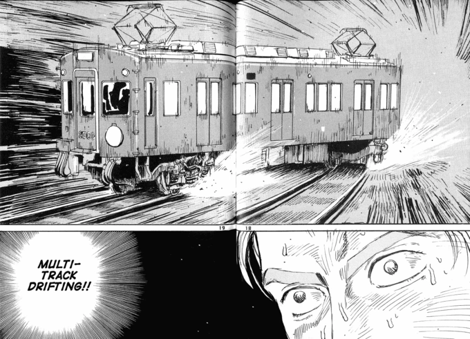
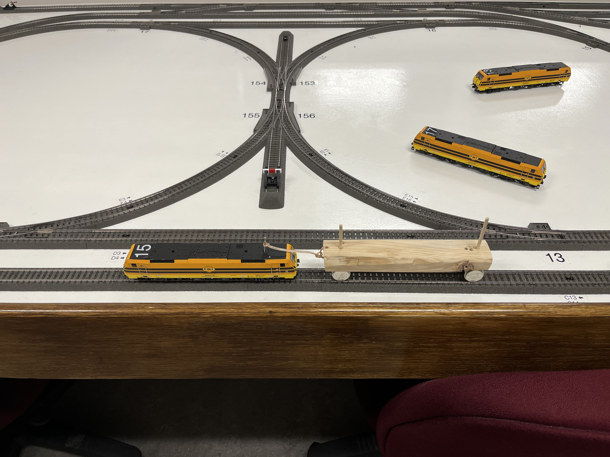
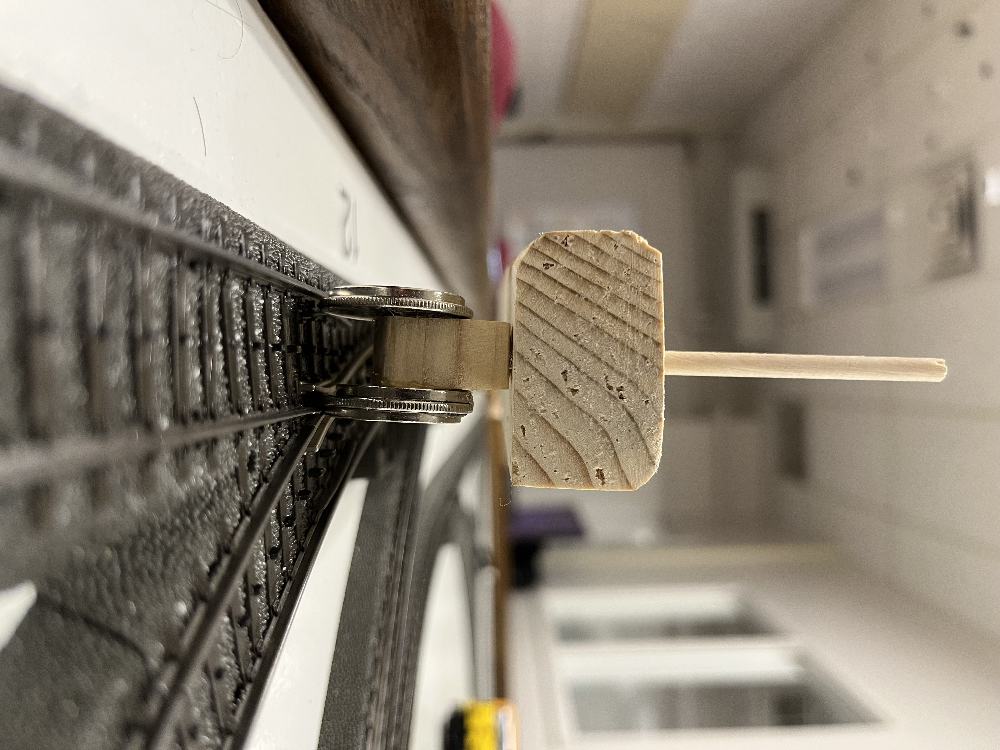
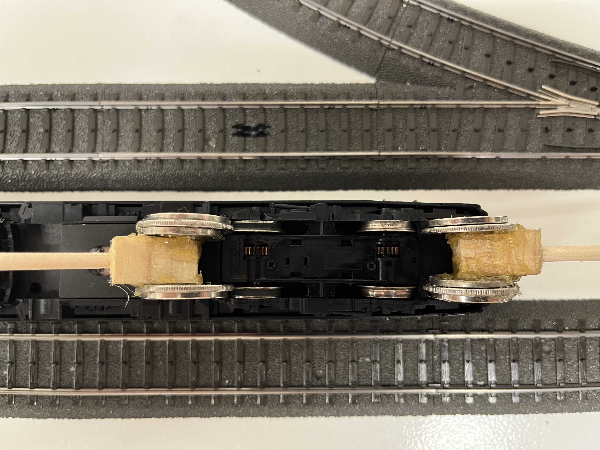
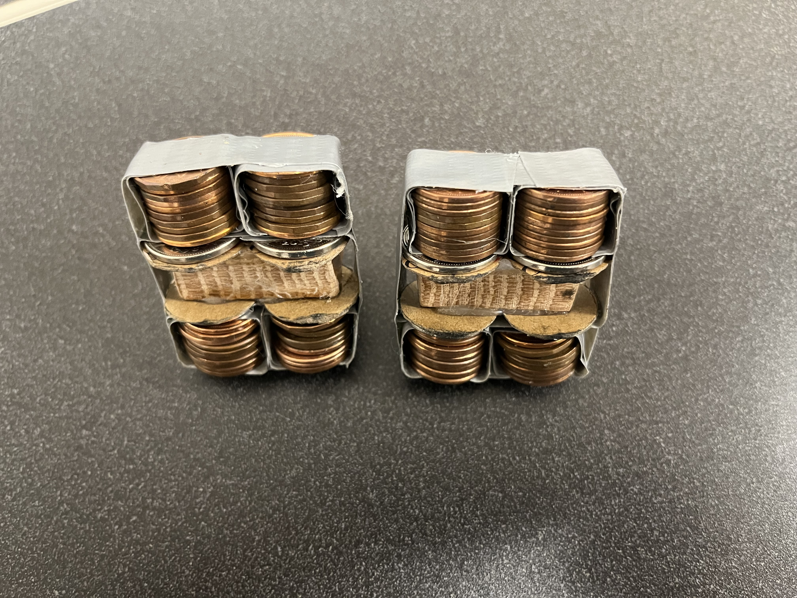
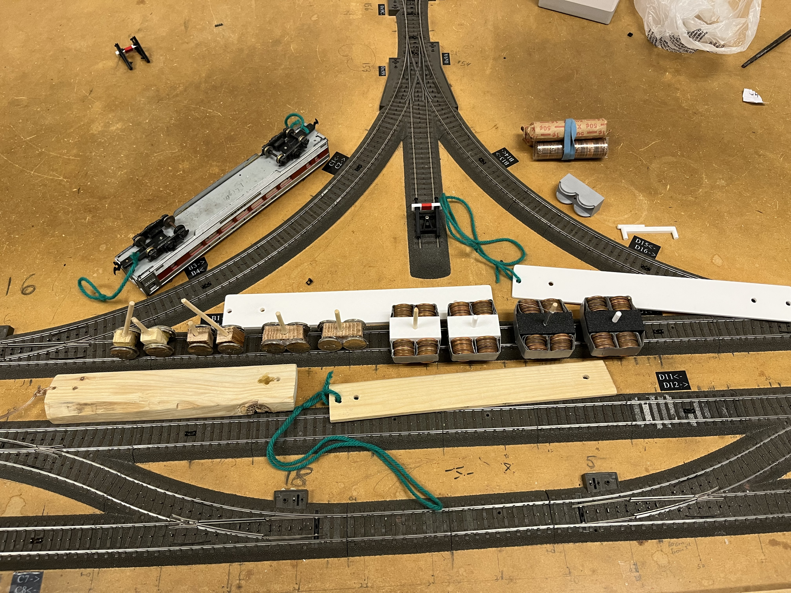
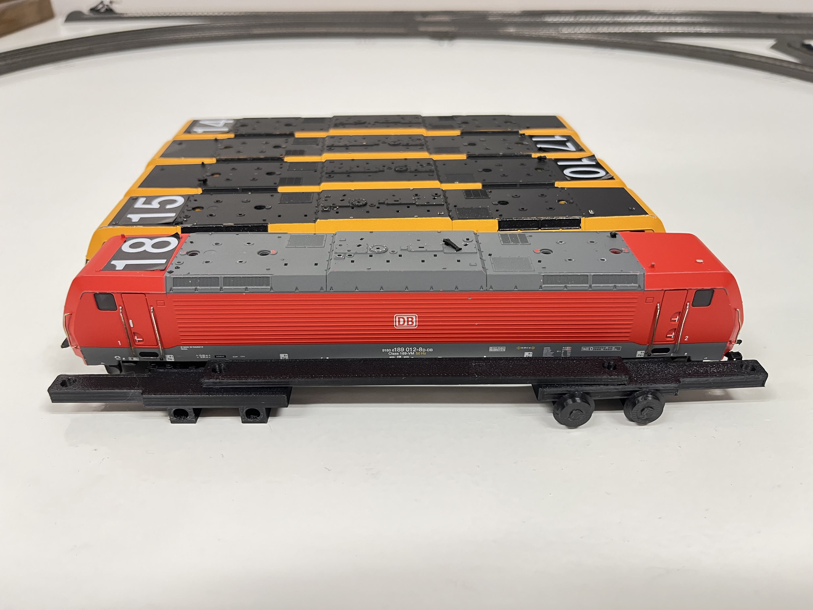
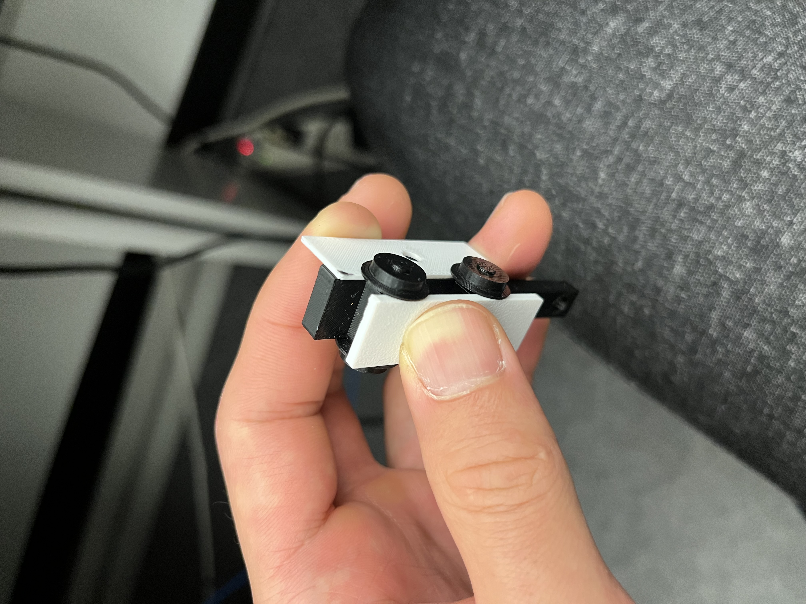
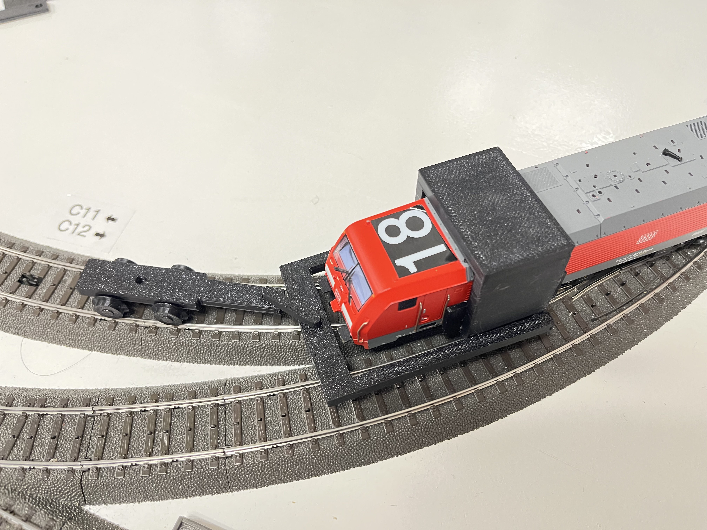

Here at the University of Waterloo, nestled deep inside a concrete bomb shelter (ie. MC), lies a lab whose course is well known to every UW CS student. Its inhabitants are known for sleeping strange hours (if they do), implementing "load-bearing prints"[1] and posting memes about their collective suffering.

Colloquially called "the trains course" (CS 452), it is a course where people spend ≥40 hours a week, for at least 3 weeks of the term (on top of other courses/responsibilities). It is a course that brings in some of the smartest people you will ever meet. That said, the only requirement for this course is the ability to suffer, ie. the grit to grind out bugs in the software and deal with uncertainty with the hardware. I don't think it's a surprise that every term in which this course is offered has around one person coming back to UW for a master's (based on my observation).

I've taken this course as an undergrad in 2023, then came back to do a master's, where I've been a teaching assistant (TA) of this course for all of 2025 and 2026. During that time, I've seen code that fundamentally changed what I thought was possible to implement in such a short timeframe. This inspired me to revisit a particular meme that was prevalent while I was taking the course -- multi-track drifting.

*[1] This is when you cannot remove a print statement from your code because the program crashes when you do. Unlike other CS courses at UW, you are implementing on bare-metal, so you have poor debuggability and errors in one task can create untraceable errors in another. In many cases, it's better to leave these be and focus on fixing actual program bugs.*

## The challenge

The Marklin trains themselves are unable to multi-track drift, as their bogies cannot rotate to that extent. Even if you modified the locomotive to allow the bogies to rotate more, there appears to be some kind of driveshaft between the two bogies, which would require extensive modifications to work around.

That shut down the initiative during my cohort. But while I was TAing, I thought: "what if I tow carriages behind the locomotive, and have the carriages multi-track instead?" What initially was supposed to take 2 weeks to make a basic model turned into 4 months of iterative R&D, as I got more and more ambitious with my designs.

## The wood era

I had scraps of wood and a hot glue gun lying around, so my first instinct was to glue coins to make a bogie. The coins would skate on the track, which is fine because metal-on-metal is low friction. To connect to the locomotive, I used a piece of wire to a nail (which I covered with hot glue after seeing it spark... nothing broke though).

This was a pain to set up, because I shaved the wood block too much.

I also realized this required being sub-millimeter precise, as there isn't much space for the flange to fit around the turnout guard rails (see the previous image).

For my second iteration, I redid the wood block so I didn't have to stack a nickel on the inside edge. Still, this falls over when the locomotive takes a corner because two wheels cannot stand on their own (hence, rediscovering why bogies use 4 wheels).

For my third iteration, I used 4 wheels per bogie. I also discovered that you can get pennies from the bank to use as weight (at 2.25g per penny, it's surprisingly viable -- dumbells are around $1 per pound). I also tried using cardstock as the flange, though it fell apart after a while.

My fourth iteration replaced the cardstock with coins, and changed the carriage to a thin piece of wood. I also changed the nail to a yarn harness for a more secure fit. All of this keeps the carriage stable and the weight low to the ground, which enabled my first multi-track drift!

<iframe width="300" height="420" src="https://www.youtube-nocookie.com/embed/WckpAAoT2Dk?si=f_Fzc6xcqf0KCXkk" title="YouTube video player" frameborder="0" allow="accelerometer; autoplay; clipboard-write; encrypted-media; gyroscope; picture-in-picture; web-share" referrerpolicy="strict-origin-when-cross-origin" allowfullscreen></iframe>

Unfortunately, the design was not robust. I left it in the lab for the students to play with, and within a few days the wheels had broken off. I needed something that didn't require fiddling with hot glue to get sub-millimeter precision. Something that a regular student could handle in a reasonable amount of time.

I went to the antique store and bought a model train carriage for $10. It even comes with train couplers, so in theory you could connect train carriages automatically (disclaimer: I haven't tested this on the track because I only bought one carriage). It can handle multi-track drifting at higher speeds than my fourth iteration.

<iframe width="300" height="420" src="https://www.youtube-nocookie.com/embed/1ecPzJ5dOkM?si=0GaBwOfi9MloNuf2" title="YouTube video player" frameborder="0" allow="accelerometer; autoplay; clipboard-write; encrypted-media; gyroscope; picture-in-picture; web-share" referrerpolicy="strict-origin-when-cross-origin" allowfullscreen></iframe>

So we went through this whole era of iterations, reached a working prototype, just to get beat by an antique store. We need to do better.

## The 3d print era

It turns out that UWaterloo has a 3d printing lab that's open to students. It also turns out that 3d printing is particularly suited to this use-case because it is sub-millimeter precise and reproducible by anyone with the STL file.

I ended up making 3 iterations, from the grey piece to the white piece to the black piece. I was playing around with the width and the flange size (this was before I found out this was standard HO scale track). I also found that I needed to switch to ultra-fine layer height (0.08mm) because the layers were catching on the rail expansion joints.

However, there is a problem with this setup. While metal-on-metal doesn't produce much friction, plastic sliding on metal causes bogies to pull on each other, leading to derailments around the corners. Adding weight doesn't solve the issue because it makes the friction problem worse. This was an issue because I had gotten inspired by a [video of multi-train multi-track drifting](https://youtube.com/shorts/0TsYlFl4dQM?si=EpKQRoe3lFx-0HSz), and I needed some way to scale to longer lengths.

<iframe width="300" height="420" src="https://www.youtube-nocookie.com/embed/kxNcKd3EEQY?si=5vViSS3Opj1U7-NU" title="YouTube video player" frameborder="0" allow="accelerometer; autoplay; clipboard-write; encrypted-media; gyroscope; picture-in-picture; web-share" referrerpolicy="strict-origin-when-cross-origin" allowfullscreen></iframe>

Unlike woodworking, 3d printing doesn't mind more complex designs. So I got to work on a wheel-and-axle design that was a bit closer to the ground. This took about 3 iterations.

To get the right width between the wheels, I found a convenient coincidence -- by putting the 2mm shim on the bottom and the 1mm shim on the side, you get just the right distance between the wheels. This is particularly nice because if you squeeze the wheels too close together, it's a pain to pry them apart.

While I was at this, I wanted to change the yarn harness for a 3d printed one for better ease-of-use and reproducibility. I spent 3 iterations perfecting the sleeve width and the binding method between the sleeve and the arm. I also found that I needed to use a longer coupler for arm-to-first-carriage than carriage-to-carriage to provide enough clearance from the arm.

Then I used two 10 penny stacks per bogie to keep the bogey firmly planted on the track. The pennies are taped to a 2mm shim that floats just above the carriage platform.

So there you have it: a reproducible multi-train multi-track drifting train model that only requires a 3d printer, tape and pennies (other weights work too) -- things that every UW student has easy access to. [The STL files and the Blender model can be found here](https://github.com/SaltOverflow/multitrain-multitrack-stl). I recommend printing the wheels at 0.08mm, while the rest can print at the default 0.2mm. I also recommend printing extra wheels and axles, because sometimes the friction fit has variation. I used PETG, but PLA is probably fine too.

## Full demo

Once you start to multi-track drift multiple carriages, manual switching becomes inconsistent because you have a little less than a second to throw the switches. Instead, I edited the K4 assignment code to automate the switching. The demo below was done at half speed (60/120 kph).

<iframe width="300" height="420" src="https://www.youtube-nocookie.com/embed/h-gCHz8Z_pY?si=NVvHeKfZQrm_Ksmh" title="YouTube video player" frameborder="0" allow="accelerometer; autoplay; clipboard-write; encrypted-media; gyroscope; picture-in-picture; web-share" referrerpolicy="strict-origin-when-cross-origin" allowfullscreen></iframe>

What else could be done to make this even better? The wheels sometimes get caught on the turnouts, which could be fixed by using a concave flange. The train platform is pretty bare-bones because I was doing basic modelling in Blender -- feel free to design fancier carriages like flatcars, boxcars and passenger cars. Automatic train coupling could be done, though it would likely require a lot of trial-and-error. I designate the safe multi-track speed as 60/120kph, but it can probably handle 80/120kph. Higher speeds like 100/120kph and above would probably benefit from lower coupler arms (the part that extends from the bogie) and more weight.

But this is as far as I'll go for now. It's a solid base that works well, and you can extend it in many ways. I might be TAing the course next term (W27) -- if I am, I look forward to seeing your final projects.

*Note: This is cross-posted with my Substack [here](https://saltoverflow.substack.com/p/the-quest-for-the-holy-multi-track). Substack has more features, but my own website gives me some room to experiment.*
